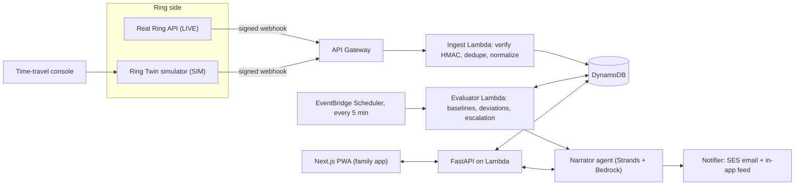

# Quiet Check-In: Product Requirements Document (PRD)

**Hackathon:** Build, Ship, Shape: Amazon Developer Hackathon **Track:** Ring (primary) · **Mini challenges:** AWS Builder + Open Source **Deadline:** Fri Oct 23, 2026, 12:00 pm PDT (that is **Sat Oct 24, 00:00 in Pakistan time**; plan to submit by **Oct 22**) **Doc status:** v1.0, written Oct 4, 2026

---

## 0. TL;DR

**Quiet Check-In** is a privacy-first caretaking app. It learns the normal daily rhythm of an older person who lives alone, using only *event metadata* from Ring devices (for example "front door motion at 7:42 am"). It stays silent when the routine is normal. When the routine breaks, it sends a gentle, human message to family ("Dad usually picks up the paper by 8:30. Nothing yet today") instead of a scary alarm.

**No video is ever fetched.** The product only reads *when* things happen, never *what the camera sees*.

**Hardware reality:** we have no Ring device. The plan is a **dual-mode Ring adapter**: the app talks to Ring through one interface, with a *LIVE* implementation (real Ring Partner API) and a *SIM* implementation (a "Ring Twin" simulator that sends Ring-formatted, HMAC-signed webhooks). The demo runs in SIM mode. See §1 for why and for the risks.

---

## 1. Ground truth about Ring (from the official docs, Oct 4, 2026)

### 1.1 What Ring gives developers

- A REST API at `https://api.amazonvision.com` plus OAuth at `https://oauth.ring.com`. Calls must be **server-to-server** (browser calls are blocked by CORS).
- **Account linking:** a Ring customer installs your app from the Ring App Store, picks which devices to share, and Ring hands your backend OAuth tokens (access token \~4 h, refresh token \~30 days, which you must refresh proactively).
- **Webhooks:** Ring POSTs JSON events to your HTTPS endpoint. Events listed in the docs: `motion_detected` (with `attributes.sub_type` such as `human`), `button_press`, `device_added`, `device_removed`, `device_online`, `device_offline`, `app_integration_added`, `app_integration_removed`, `subscription_activated`, `subscription_deactivated`.
- Webhook rules: HMAC-SHA256 signature in the `X-Signature` header (hex digest, `sha256=` prefix), **return 200 within 5 seconds**, dedupe using `meta.request_id`.
- Other endpoints: device list/status/capabilities, **Event History** (`GET /v1/history/devices/{id}/events`), WHEP live video, MP4 clips, snapshots, chimes, and sensors (contact, flood/freeze, temperature/humidity, air quality). We will **not** use video, clips, or snapshots.
- Pause/resume an integration: `PATCH /v1/accounts/me/app-integrations` with `status: awaiting | completed`. We use this for the "elder pause" privacy control.
- The docs say there is **no official Ring SDK**, so plain HTTP clients are used.
- Credentials (Client ID, Client Secret, HMAC key) are shown **once** at app creation. Store them immediately in a secrets manager.
- Ring offers a **Ring MCP server** that gives an AI coding assistant the Ring docs. We will use it while building.

### 1.2 The hardware problem (important)

- The Getting Started page lists "at least one Ring device" as a requirement.
- The Test guide says testing uses **your own Ring account with real devices**, a Ring Protection plan, and **US-located devices only**. Up to 10 staging users.
- The glossary and FAQ also mention a **Sandbox Environment with synthetic devices and events**, but the Test guide does not explain how to get it.
- The hackathon rules say a physical device is **not required** and that Ring is "demonstrated through a simulator or an actual Ring device", with "any Ring API, SDK, simulator, or device listed in Ring's developer documentation" acceptable.

**Our response:**

1. Today: register a Ring developer account and create an app, to get real staging credentials (Client ID, Secret, HMAC key). We use the real HMAC key to sign simulator events, so our verification code is the real production code path.
2. Today: ask in the Ring Developer Community and at hackathon office hours how to access the sandbox.
3. Build the **Ring Adapter** with two modes (§9 and §10). If the sandbox or a real device becomes available, we flip one config value to LIVE.
4. **Go/No-Go gate on Oct 6** (see §19).

---

## 2. Problem and users

### 2.1 Problem

Adult children worry about parents who live alone. Today's options are bad:

- **Cameras** feel invasive, and the parent often refuses them.
- **Panic buttons** only work if the person is conscious and willing to press them.
- **Phone calls** are tiring for both sides, and a missed call creates anxiety rather than information.

Families want a quiet answer to one question: **"Is today going the way a normal day goes?"**

### 2.2 Personas (also the demo cast; set in the US because Ring devices are US-only)

| Persona | Description | Needs |
| --- | --- | --- |
| **Frank (78)**, the "elder" | Lives alone in Phoenix. Independent. Dislikes surveillance. Has a Ring doorbell and a contact sensor on the back door. | No video. Control over what is shared. Ability to pause. |
| **Maya (45)**, primary family contact | Daughter in Austin. Busy, anxious. | Calm updates, no false alarms, one-tap "I called him". |
| **Sam (42)**, secondary contact | Frank's neighbor. | Gets asked only if Maya doesn't respond. |

---

## 3. Product scope

### 3.1 MVP (must ship)

1. Ingest Ring-style events through a signed webhook (SIM now, LIVE-ready).
2. Learn a per-person **routine baseline** (anchors and time windows).
3. Detect **deviations** (missed anchor, long inactivity, unusual night activity).
4. A **deterministic escalation engine** (never LLM-decided).
5. An **AI narrator** (Bedrock + Strands) that writes gentle messages and answers family questions via tools.
6. **Family web app (PWA):** today's status, timeline, alerts, acknowledge, settings.
7. **Ring Twin simulator** with a time-travel demo console.
8. **Evaluation harness** that reports detection precision/recall on simulated personas.
9. Open-source kit `ring-partner-kit` (Open Source mini challenge).
10. Full submission package (repo, video, feedback, friction log).

### 3.2 Stretch (only if MVP is done by Oct 17)

- LIVE mode against a real or sandbox Ring account.
- Contact-sensor signals (fridge or medicine cabinet) if the docs confirm sensor events.
- Weekly "calm digest" email.
- Hosting the agent on **Bedrock AgentCore Runtime**.

### 3.3 Non-goals

- No video, image, or audio processing. No facial recognition.
- Not a medical device and not an emergency service. It never says "emergency" and never calls 911.
- No Ring App Store publishing or certification during the hackathon.

---

## 4. Key user flows

### Flow A: Onboarding (family + elder consent)

1. Maya signs in (Cognito).
2. She creates a "Care circle" for Frank and chooses which signals count (doorbell, back door, etc.).
3. Frank's consent step shows exactly what is read ("times only, no video"). Consent is recorded with a timestamp.
4. LIVE: Ring account linking. SIM: "Connect demo home" button starts a Ring Twin scenario.

### Flow B: Learning period

- Days 1-5: status shows "Learning Frank's routine" and **no alerts are sent**.
- After the warm-up, the baseline goes live. In SIM we pre-seed 21 days of history through the backfill path so the demo starts with a mature baseline.

### Flow C: Normal day

- Maya sees a calm green card ("Normal morning: back door at 7:12, paper at 8:05"). No notification is sent.

### Flow D: Routine break

1. Frank's usual "paper pickup" window (7:30-8:50) passes with no event.
2. **L1:** Maya gets a gentle message.
3. She taps **"I called, all good"** (acknowledged, anchor muted for today, feedback stored) or **"Can't reach him"**, which triggers escalation to Sam after N minutes.
4. If nobody acknowledges, **L2** notifies Sam, then **L3** shows a clear "consider calling or visiting" card.

### Flow E: Elder control

- Frank can **pause** ("I'm away this week") using the elder link, which calls `PATCH app-integrations status=awaiting` in LIVE mode and sets "Away" mode in SIM. Alerts are suppressed and Maya is told it was Frank's choice.

---

## 5. Functional requirements

| ID | Requirement | Priority |
| --- | --- | --- |
| FR-1 | Expose `POST /webhooks/ring`, verify the HMAC-SHA256 signature over the **raw body**, reject mismatches, respond 200 in under 5 s, process asynchronously. | P0 |
| FR-2 | Idempotent processing keyed on `meta.request_id` (store with TTL). | P0 |
| FR-3 | Normalize events into an internal `Signal` (person, device, kind, sub_type, ts_utc, local_ts). | P0 |
| FR-4 | Clock abstraction: all "now" calls go through a `Clock` that can be real or virtual (for demo time-travel and tests). | P0 |
| FR-5 | Baseline learning: anchors and windows per person and day type (weekday/weekend). | P0 |
| FR-6 | Evaluator runs every 5 minutes and creates `Observation` records (normal, overdue, silent, unusual). | P0 |
| FR-7 | Escalation ladder with configurable timings, quiet hours, and per-contact preferences. | P0 |
| FR-8 | Suppression: device offline, Away mode, snooze, recent acknowledgment. | P0 |
| FR-9 | Notifications: in-app feed (always) plus email via SES. | P0 |
| FR-10 | AI narrator composes messages from structured facts only. | P0 |
| FR-11 | Family chat: "Did Dad get his paper today?" answered via agent tools. | P1 |
| FR-12 | Ring Twin simulator with scenario library and time-travel console. | P0 |
| FR-13 | Backfill path using the Event History client (real) or simulator (SIM). | P0 |
| FR-14 | Token manager: proactive refresh every 24 h, 401 handling, expiry alerts (LIVE). | P1 |
| FR-15 | Elder consent record, pause/resume, "delete my data". | P0 |
| FR-16 | Evaluation harness (`make eval`) with precision/recall report. | P0 |
| FR-17 | Admin/debug page showing raw events, baseline, and why an alert fired ("explainability"). | P1 |

---

## 6. Routine intelligence (the core algorithm)

### 6.1 Signals

Signals come from: doorbell `button_press` (visitors), camera `motion_detected` (with `sub_type`, for example `human`), and, if confirmed in the docs, contact-sensor open events. Each signal is a **timestamp plus a device label**, nothing else.

### 6.2 Anchors

An **anchor** is a regular daily behaviour, for example "back door opens in the morning".

1. For each device and day type, take the last 14-28 days of events.
2. Convert times to minutes after local midnight and run a **kernel density estimate**.
3. A density peak that occurs on **at least 60% of comparable days** becomes an anchor.
4. Compute the window: `median ± max(45 min, 2.5 × 1.4826 × MAD)`, with the end padded by a configurable grace (default 30 min).
5. Store `reliability` (the share of days with an event inside the window).

*Why MAD and KDE:* both are robust to the odd late morning, and both are explainable in the UI ("usually 7:30-8:50, seen on 17 of 20 days").

### 6.3 Deviation types

| Type | Rule | Default severity |
| --- | --- | --- |
| **Missed anchor** | No qualifying event by window end plus grace, and anchor reliability is at least 0.7. | Medium |
| **Long silence** | No signals on **any** device for X hours during the person's usual waking period (X learned from history, minimum 8 h). | High |
| **Unusual night activity** | Multiple events in the person's usual sleeping period, unlike the baseline. | Medium |
| **Device health** | A device is offline or a sensor is silent for a long time (this is *not* about the person). | Info |

### 6.4 Suppressors (to protect trust)

- `device_offline` within the lookback means "can't tell", so **no inactivity alert**, only a device-health note.
- Away mode, snoozed anchors, and a recent family acknowledgment suppress the alert.
- Hard cap: at most 2 proactive notifications per person per day unless the severity rises.

### 6.5 Escalation ladder (configurable)

| Level | Trigger | Recipient | Tone |
| --- | --- | --- | --- |
| L0 | Anchor overdue by less than grace | In-app only | "Still early" |
| L1 | Overdue past grace | Primary contact | Gentle nudge |
| L2 | L1 not acknowledged in 45 min | Secondary contact | Ask for a neighborly check |
| L3 | L2 not acknowledged in 60 min, or Long silence | Both | "Consider calling or visiting"; links to local non-emergency guidance |

Quiet hours (default 10 pm-7 am) hold L0-L1 until morning. L3 is allowed through when severity warrants it.

### 6.6 Learning from feedback

Every "I called, all good" marks that alert as a **false positive** and widens the window for that anchor by a bounded amount (for example +15 minutes, max 90). Every "Can't reach him" confirmation raises confidence in the alert type.

---

## 7. Architecture



### 7.1 Components

- **Ring Adapter:** `RingGateway` interface with `list_devices()`, `get_history()`, `refresh_token()`, `verify_webhook()`. Two implementations: `RingLive`, `RingSim`.
- **Ingest:** thin and fast. Verify, dedupe, store, enqueue. It must always return 200 within 5 seconds.
- **Evaluator:** pure functions over (signals, baselines, clock) so that tests can run in-process without AWS.
- **Narrator:** receives *structured facts*, returns text. It never sees raw logs and has no ability to alter alert decisions.
- **Family app:** reads state from the API. Updates by polling every 15 s (SSE is optional).

---

## 8. Technology stack

| Layer | Choice | Why |
| --- | --- | --- |
| Backend language | **Python 3.12 + FastAPI** | Ring's own examples are Python, Strands has a mature Python SDK, easy statistics (numpy/scipy). |
| Hosting | **AWS Lambda + API Gateway (HTTP API)** via **AWS SAM** | Public HTTPS endpoint for webhooks with almost no ops; fits the AWS Builder challenge. |
| Database | **DynamoDB** (on-demand, single table, TTL on raw events) | Cheap, serverless, good fit for time-series-like items. |
| Scheduling | **EventBridge Scheduler** (5-minute tick) | Absence detection needs a scheduler (the silence *is* the event). |
| AI | **Amazon Bedrock** (Claude via Converse API) + **Strands Agents SDK** + **Bedrock Guardrails** | Multi-service agentic design (rubric calls a single Bedrock call "obvious"). |
| Agent hosting (stretch) | **Bedrock AgentCore Runtime** | Documented AWS integration for extra credit. |
| Notifications | **Amazon SES** (email) + in-app feed (+ optional Web Push) | SES is simple; verify sender and recipients (sandbox). |
| Auth | **Amazon Cognito** (user pool) with seeded demo users | No custom auth code. |
| Secrets | **AWS Secrets Manager / SSM SecureString** | Ring Client Secret and HMAC key are shown only once. |
| Frontend | **Next.js (App Router) + TypeScript + Tailwind + shadcn/ui**, PWA | Mirrors Ring's own Next.js sample; fast UI. Hosted on **AWS Amplify Hosting**. |
| Dev tooling | **Kiro** (spec-driven dev; qualifies for AWS Builder on its own), **Ring MCP server**, pytest, ruff, GitHub Actions | Speed plus documented process. |
| Observability | CloudWatch Logs + structured JSON logs, X-Ray optional | Debuggable demo. |

**Region:** `us-east-1` (widest Bedrock model availability; confirm model access in the Bedrock console and use the model IDs shown there, since they change).

---

## 9. Ring integration specification

### 9.1 Endpoints used (LIVE)

| Purpose | Call |
| --- | --- |
| Token refresh | `POST https://oauth.ring.com/oauth/token` (`grant_type=refresh_token`) |
| User/account id | `GET /v1/users/me` |
| Devices | `GET /v1/devices?include=status,capabilities` |
| Event history (backfill) | `GET /v1/history/devices/{device_id}/events` |
| Pause/resume | `PATCH /v1/accounts/me/app-integrations` (`status`) |
| Webhooks | `POST /webhooks/ring` (ours) |

Rate limit is 100 requests per second per partner; use exponential backoff on 429 and respect `Retry-After`. Never put a refresh token in an `Authorization: Bearer` header (that returns 401).

### 9.2 Webhook verification (reference implementation)

```python
import hmac, hashlib

def verify_ring_signature(raw_body: bytes, header: str, hmac_key: str) -> bool:
    expected = "sha256=" + hmac.new(hmac_key.encode(), raw_body, hashlib.sha256).hexdigest()
    return hmac.compare_digest(expected, header or "")
```

Rules: compute over the **raw bytes** (not re-serialized JSON), use constant-time comparison, respond 200 fast, then process asynchronously. Dedupe on `meta.request_id`.

### 9.3 Account linking (LIVE only)

Docs describe one-way linking (HMAC nonce, claim token, `POST` then `PATCH` to `completed`). We implement it behind the same adapter only if we reach LIVE mode. In SIM, "Connect demo home" skips it.

### 9.4 Items we must verify in the docs before coding (open questions)

1. The exact **Webhook v1.1 payload structure** (field names under `data`, `attributes`, `meta`). We will copy the doc's example payload into `ring-partner-kit` fixtures.
2. Whether **contact sensors** emit webhooks or must be polled.
3. How to get **sandbox** access, if at all.
4. The format of **Event History** responses (pagination, time filters).

---

## 10. "Ring Twin" simulator specification

**Goal:** show the app working "through a simulator", with signed webhooks so real as to exercise the real verification and ingest code.

- **Scenario engine:** a persona YAML defines routines with jitter, for example `back_door: 07:10 ± 20 min` and `paper: 08:00 ± 25 min`, plus weekend variants, visitors, and random misses.
- **History seeding:** generate 21-28 days into the past and load it through the normal backfill path.
- **Live mode:** emit events as the (virtual) clock advances. POST each as a Ring-shaped JSON body with `X-Signature` computed using the real HMAC key and a unique `meta.request_id`.
- **Fault injection:** drop events, duplicate events (tests idempotency), delay events, send a bad signature (tests rejection), take a device offline.
- **Time-travel console (demo):** buttons for "Fast-forward to 8:50 am", "Frank skips his routine", "Door opens at 9:05", "Device offline", "Frank goes away".
- **Mock History API:** serves the same events for the Event History client.
- **Honesty requirement:** the README, the video, and the Devpost text must state clearly that the demo uses a simulator and which parts are real (verification, parsing, client code) versus simulated (the Ring cloud).

---

## 11. Data model (DynamoDB single table)

| Entity | PK | SK | Key attributes |
| --- | --- | --- | --- |
| Care circle | `CIRCLE#id` | `META` | elder name, timezone, mode (LIVE/SIM), away_until |
| Member | `CIRCLE#id` | `MEMBER#uid` | role (primary/secondary/elder), contact prefs, quiet hours |
| Consent | `CIRCLE#id` | `CONSENT#ts` | scope, text version, granted_by |
| Device | `CIRCLE#id` | `DEVICE#id` | label, kind, status, last_seen |
| Signal | `CIRCLE#id#DAY#yyyymmdd` | `TS#ts#reqid` | device, kind, sub_type, `ttl` (30 days) |
| Dedupe | `REQ#request_id` | `META` | `ttl` (48 h) |
| Anchor/baseline | `CIRCLE#id` | `ANCHOR#device#daytype#n` | window_start, window_end, reliability, support_days, version |
| Observation | `CIRCLE#id` | `OBS#ts#type` | type, severity, evidence (facts JSON) |
| Alert | `CIRCLE#id` | `ALERT#ts` | level, status, ack_by, message, narrator_model |
| Virtual clock | `CIRCLE#id` | `CLOCK` | sim_now |
| Token (LIVE) | `CIRCLE#id` | `RINGTOKEN` | encrypted refresh token, expiry |

---

## 12. API surface (family app)

- `GET /circles/{id}/today` → status card, anchors with state, recent signals
- `GET /circles/{id}/timeline?day=`
- `GET /circles/{id}/baseline` → anchors and "why" explanation
- `POST /alerts/{id}/ack` (`ok` or `cant_reach`)
- `POST /circles/{id}/away` / `DELETE`
- `POST /circles/{id}/chat` → narrator agent answer
- `POST /sim/advance`, `POST /sim/inject` (SIM only, auth required)
- `GET /healthz`

---

## 13. AI specification (Bedrock + Strands)

### 13.1 Division of labour

- **Deterministic engine** decides *whether* to alert and at what level.
- **LLM** only decides *how to say it*, and answers questions through tools.

### 13.2 Agent tools (Strands)

`get_today_status(circle)`, `get_anchor_explanation(anchor)`, `get_recent_signals(circle, hours)`, `acknowledge_alert(alert, result)`, `set_snooze(anchor, minutes)`.

### 13.3 Prompting rules

- Input is a **fact object** (anchor name, usual window, observed count, support days, last activity, device health). No raw timestamps for unrelated devices.
- Output limits: at most 2 sentences, warm, no diagnosis, no alarmist words, no claims about health or safety.
- Always include the *evidence* ("usually 7:30-8:50, seen on 17 of 20 days") so the family can judge.
- Every alert message includes a one-tap action.
- **Bedrock Guardrails:** block medical advice and emergency claims; deny topics outside the care circle.
- **Fallback:** if Bedrock is unavailable, use a template message so the alert is never lost.

### 13.4 Example output

> "Frank usually picks up the paper by 8:30. Nothing yet this morning. It may be nothing, but a quick call could settle it."

---

## 14. UX requirements

Screens: **Today** (green/amber/red status, plain-language summary), **Timeline**, **Routine** (anchors with "usually X-Y, seen N of M days"), **Alerts**, **Care circle & consent**, **Settings** (quiet hours, thresholds), **Demo console** (SIM only).

Principles: calm colors, large text, no jargon, no red unless L3. Every alert states *why* it fired. The elder's consent and pause are always one tap away. Accessibility: WCAG AA contrast, keyboard navigable, screen-reader labels.

---

## 15. Privacy, security, safety

- **Data minimization:** store timestamps and device labels only. Never request live video, clips, or snapshots.
- **Consent:** the elder consents explicitly. The family cannot add devices without it.
- **Retention:** raw signals expire after 30 days (TTL). Baselines keep aggregates only.
- **Deletion:** one-click "delete my data" (erases circle data).
- **Security:** webhook HMAC with constant-time compare, secrets in Secrets Manager, least-privilege IAM, encrypted tables, no credentials in the repo (add secret scanning to CI), CORS locked down, input validation.
- **Safety framing:** displayed on first run and in settings: "Not an emergency service. If you think someone is in danger, call local emergency services."
- **Compliance note:** if ever published to the Ring App Store, Ring's certification and content policy apply. Out of scope for the hackathon.

---

## 16. Non-functional requirements

| Area | Target |
| --- | --- |
| Webhook latency | p95 under 500 ms; hard limit 5 s |
| Detection delay | Alert within 10 minutes of the grace window ending |
| Reliability | Ingest idempotent; evaluator safe to re-run |
| Cost | Under $10 total during the hackathon (on-demand services; credits available) |
| Reproducibility | A reviewer can clone, run `make demo`, and see the full scenario locally in under 10 minutes |

---

## 17. Testing and evaluation

- **Unit tests:** signature verification (good/bad/tampered), dedupe, anchor extraction, window math, suppressors, escalation state machine.
- **Property tests:** the evaluator never alerts during warm-up or Away mode.
- **Integration tests:** simulator → ingest → evaluator → notification in-process with a fake clock.
- **Evaluation harness (`make eval`):** simulate 5 personas × 30 days with injected breaks and benign deviations (late sleeper, holiday). Report precision, recall, mean detection delay, and false alerts per person-month. Target: **recall at least 90%** on injected breaks, **fewer than 1 false L1 per person per month**. Publish the numbers in the README and the video. They make the "potential impact" claim credible.
- **Chaos checks:** duplicate events, out-of-order events, device offline.

---

## 18. Hackathon strategy and compliance

### 18.1 Judging criteria mapping

| Criterion | How we score |
| --- | --- |
| **Tech implementation** | Real HMAC verification, Ring-shaped ingest, token manager, Event History client, deterministic engine with tests, eval numbers, clean IaC. |
| **Design** | Calm, explainable UI; elder consent and pause; one coherent story from onboarding to alert to acknowledgment. |
| **Potential impact** | Real caregiving need; privacy-first (no video) lowers adoption friction; measurable accuracy. |
| **Quality of the idea** | Non-security caretaking use case (rubric names it "creative"), multi-service AWS pipeline, absence detection as the product. |

### 18.2 Mini challenges

- **AWS Builder:** Bedrock + Strands (+ Guardrails) + Lambda + DynamoDB + EventBridge + SES + Cognito + Secrets Manager (+ AgentCore stretch). Describe each in the Product Feedback answer. Building with Kiro also qualifies.
- **Open Source:** a separate public repo **`ring-partner-kit`** (MIT): webhook verifier, idempotency helper, typed event models, token manager with proactive refresh, Event History client, and the `ring-twin` simulator CLI. The Ring docs state there is no official SDK, so this helps other developers. Include the contribution URL, repo URL, your GitHub username, and a short description in the submission.

### 18.3 Submission checklist

- [ ] Devpost registration (Join hackathon) and a free AWS credits request (form due Oct 21, 12:00 pm PT)
- [ ] Public GitHub repo with an OSI license visible in the About section (or a private repo shared with [testing@devpost.com](mailto:testing@devpost.com) and the six Amazon reviewers, with invitations accepted at submit time)
- [ ] README: setup and run instructions, architecture, "what is simulated"
- [ ] Repo **imports and calls** the Ring-specific code at runtime (not only mentioned in the README)
- [ ] Demo video: under 3 minutes, public on YouTube or Vimeo, English, no copyrighted music, shows the project running (simulator)
- [ ] Text description
- [ ] Product feedback for **every** tool/API/SDK used (Ring API, Ring MCP, Bedrock, Strands, SAM, Kiro, etc.), including AWS services used
- [ ] Track (Ring) and mini challenges (AWS Builder, Open Source) selected
- [ ] Friction log entries (up to a 10% bonus): keep a running `FRICTION.md` from day 1
- [ ] Optional feature requests
- [ ] If the project predates the hackathon: explain what was built during the window (this project is new)

---

## 19. Timeline (Oct 4 → Oct 22, Pakistan time)

| Dates | Milestone | Exit criteria |
| --- | --- | --- |
| **Oct 4-6** | **Phase 0, setup and de-risk** | Ring developer account and app created (credentials stored); question posted about sandbox; AWS credits form submitted; Bedrock model access enabled; SAM skeleton deployed with a public `/healthz`; Ring MCP connected; `FRICTION.md` started. **Go/No-Go (Oct 6):** if the docs and community show no workable simulator path *and* you judge the risk too high, pivot to the **Alexa+ simulated path** (rules allow it, no hardware). |
| **Oct 7-9** | Ring Twin + ingest | Signed webhooks flow end to end; dedupe and bad-signature tests pass; 21-day backfill works |
| **Oct 10-13** | Routine engine | Anchors and windows extracted; deviation rules; suppressors; escalation state machine; unit tests green |
| **Oct 14-16** | Agent + notifications | Narrator with fact objects, tools, Guardrails; SES email; chat; template fallback |
| **Oct 17-18** | Family app | Today, Timeline, Routine, Alerts, consent/pause, demo console |
| **Oct 19** | Evaluation + extract kit | `make eval` report; `ring-partner-kit` repo published with license and README |
| **Oct 20** | Docs + feedback | README, architecture diagram, Product Feedback text, friction log polished |
| **Oct 21** | Video | Record, edit, upload (YouTube/Vimeo, public) |
| **Oct 22** | **Submit** | Fresh-clone test passes; submit on Devpost with one day of buffer |

Scope rule: if any milestone slips by more than one day, cut stretch items first, never evaluation or the video.

---

## 20. Risks and mitigations

| Risk | Impact | Mitigation |
| --- | --- | --- |
| Judges question a simulator-only Ring demo | High | Rules allow simulators; use the real HMAC/verification path and Ring-formatted payloads; be explicit about what is simulated; ask organizers early; stretch to LIVE/sandbox. |
| Ring developer registration needs ID verification or is slow | Medium | Start Oct 4; the simulator works without it, but the real credentials strengthen the story. |
| Webhook v1.1 schema mismatch | Medium | Copy exact examples from the docs into fixtures; contract tests. |
| Bedrock model access or quota delays | Medium | Enable access on Day 1; template fallback; Strands model is swappable. |
| False alerts destroy trust | High | Warm-up period, suppressors, rate caps, eval harness, feedback loop. |
| Scope creep | High | MVP list is fixed; stretch only after Oct 17. |
| Demo fails live or in video | Medium | Deterministic scenarios, virtual clock, record multiple takes. |
| Cost overrun | Low | On-demand services, budgets alarm at $10. |

---

## 21. Demo video script (target 2:50)

- **0:00-0:20 (hook):** Frank, 78, lives alone and refuses cameras. Maya, his daughter, lives far away. "What if she could know that today is normal, without watching him?"
- **0:20-0:50:** Onboarding and consent ("times only, no video"). Show the baseline: "usually 7:30-8:50, seen 17 of 20 days."
- **0:50-1:20:** Normal morning, quiet green card, no notification.
- **1:20-2:05:** Demo console: Frank skips his routine. Grace window passes. The narrator's gentle message arrives. Maya taps "Can't reach him". Escalation reaches Sam. Show the "why this fired" evidence panel.
- **2:05-2:30:** Under the hood: signed Ring webhooks, HMAC verification, deterministic engine, Bedrock/Strands narrator, AWS architecture in one slide, eval numbers.
- **2:30-2:50:** Impact and the open-source `ring-partner-kit`. State clearly that the Ring cloud is simulated.

---

## 22. Definition of done

- All P0 requirements implemented and tested; `make demo` and `make eval` work from a fresh clone.
- Public repo with license, README, and architecture diagram; `ring-partner-kit` published.
- Video, description, Product Feedback, and friction log submitted before the deadline.