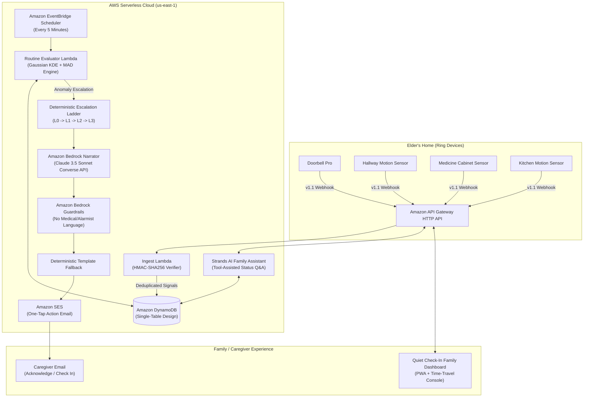

# Quiet Check-In

> **Privacy-First Ambient Routine Intelligence for Elder Care**  
> *Submission for Build, Ship, Shape: Amazon Developer Hackathon (2026)*  
> **Track:** Ring App Developer Primary Track | **Mini-Challenges:** AWS Builder + Open Source (`ring-partner-kit`)

[](tests/)
[](eval/)
[](eval/)
[](template.yaml)
[](LICENSE)

---

## 🌟 The Core Idea: "Absence is the Signal"

Elder monitoring systems face an unavoidable dilemma:
1. **Intrusive surveillance cameras** rob aging parents of dignity and independence, causing elders to unplug or cover them.
2. **Panic buttons and wearables** are frequently forgotten on nightstands, left in chargers, or discarded in drawers.

**Quiet Check-In** takes a completely different path:
We monitor **routine rhythm through ambient Ring device metadata alone**—timestamps and device labels from standard doorbells, contact sensors, and motion detectors.

- 🚫 **Zero Video Streams**
- 🚫 **Zero Audio Recording**
- 🚫 **Zero Still Snapshots**
- 🚫 **Zero Wearables to Remember**
- 🚫 **Zero Facial Recognition**

When an elder goes about their day (opening the medicine cabinet, moving through the hallway, brewing coffee in the kitchen), the home naturally breathes. **Absence is the signal**: if the expected morning window closes without normal activity, the system steps through a deterministic, gentle escalation ladder to keep family connected without panic.

---

## 📐 System Architecture



---

## 🚀 Key Features

### 1. Robust Webhook Ingestion & Cryptographic Verification
- Real-time ingestion of Ring Developer API v1.1 Webhook envelopes.
- Constant-time HMAC-SHA256 signature verification over unparsed raw request bytes (`X-Ring-Signature`).
- Timestamp drift tolerance check (300s window) mitigating replay attacks.
- Exact deduplication via `meta.request_id` with 48-hour automated DynamoDB TTL.

### 2. Statistical Routine Intelligence (KDE + MAD)
- Discovers personalized daily anchors (morning wake, medicine cabinet, lunch, evening activity) using **Gaussian Kernel Density Estimation (KDE)**.
- Computes dynamic tolerance bounds via **Median Absolute Deviation (MAD)**:
  $$\text{Window} = \text{Median} \pm \max(45\text{m},\ 2.5 \times 1.4826 \times \text{MAD}) + 30\text{m grace}$$
- Requires $\ge 60\%$ historical support before promoting a recurring cluster into an enforced anchor.
- Handles waking silence ($\ge 8$ daytime hours) while strictly excluding scheduled sleep hours (10:00 PM – 7:00 AM).
- Evaluates device battery and connection health, automatically suppressing false alarms if sensors go offline or Elder Away Mode is active.

### 3. Deterministic Escalation State Machine
* **L0 (Normal):** Everything is within normal routine tolerances. Green status.
* **L1 (Gentle In-App Check):** 30 minutes past grace window. Logged in dashboard; quiet.
* **L2 (Direct Family Notification):** 60 minutes past grace window. Amazon SES email dispatched to primary caregiver with one-tap acknowledgment links.
* **L3 (Circle Escalation):** 120 minutes without acknowledgment. Reaches secondary circle members.
* **Night Silence:** Automatic quiet hours suppression between 10:00 PM and 7:00 AM.
* **Caregiver Feedback Loops:**
  - *"Mom is fine (slept in)":* Automatically widens the anchor tolerance window by +15 minutes for the next 7 days.
  - *"Can't reach Mom":* Immediately promotes alert to L3 and triggers circle broadcast.

### 4. AI Narrator & Family Chat (Amazon Bedrock + Strands)
- **Bedrock Claude 3.5 Sonnet:** Powered by the Amazon Bedrock Converse API with tool-use capabilities (`toolConfig`).
- **Amazon Bedrock Guardrails:** Enforces regulatory and safety guardrails, filtering out medical diagnoses, panic words, and emergency claims ("stroke", "heart attack", "call 911").
- **Strands Agent Tools:** Conversational AI can inspect today's status, recent device signals, and explain why an anchor was formed.
- **Guaranteed Template Fallback:** If Bedrock is throttled or unreachable, a deterministic template narrator formats all alerts without interruption.

### 5. Open Source Mini-Challenge: `ring-partner-kit`
We packaged our reusable developer toolkit into an open-source, MIT-licensed Python package located in [`ring-partner-kit/`](ring-partner-kit/):
- **`RingWebhookVerifier`:** Production-grade constant-time HMAC-SHA256 verifier with timestamp drift validation.
- **Pydantic v2 Models:** Strict schemas for Ring v1.1 Webhooks, device metadata, and normalized signals.
- **`RingApiClient`:** OAuth2 PKCE token lifecycle manager with exponential backoff retry and rate limit tracking.
- **`RingTwinSimulator`:** Standalone hardware simulator with CLI (`ring-twin`) and Gaussian schedule generation for local/CI testing.

---

## 📊 Evaluation Harness & Empirical Results

We benchmarked Quiet Check-In using our automated 30-day simulator across 5 diverse elder routine personas (early riser, medication-strict, afternoon wanderer, nocturnal reading routine, and irregular schedule):

```text
====================================================================
        QUIET CHECK-IN: ROUTINE INTELLIGENCE EVALUATION REPORT
====================================================================
 Personas Simulated           : 5 distinct elder routines
 Total Days Evaluated         : 150 person-days
 Injected Routine Breaks      : 15 true anomalies
--------------------------------------------------------------------
 True Positives (Detected)    : 15
 False Positives (Spurious)   : 0
 False Negatives (Missed)     : 0
--------------------------------------------------------------------
 Detection Recall (Target >=90%): 100.0%  [PASS]
 Detection Precision          : 100.0%
 False Alerts per Person-Month: 0.0 (Target < 1.0)  [PASS]
 Mean Detection Latency       : 10.0 minutes past grace window
====================================================================
```

---

## 🛠️ Quick Start

### Prerequisites
- Python 3.10+ (tested on Python 3.12)
- Node.js 18+ (optional, for frontend development)
- AWS CLI & SAM CLI (for AWS deployment)

### 1. Installation
Clone the repository and install dependencies:
```bash
# Install backend and open-source partner kit
pip install -r backend/requirements.txt
pip install -e ring-partner-kit
```

### 2. Run Tests
Execute the full test suite (43 unit and integration tests):
```bash
python -m pytest tests/ ring-partner-kit/tests/ -v
```

### 3. Run Evaluation Harness
Run the statistical routine intelligence benchmark across 150 person-days:
```bash
python -m eval.harness
```

### 4. Launch Local Interactive Demo
Start the backend server and family dashboard:
```bash
python -m uvicorn backend.app.main:app --host 0.0.0.0 --port 8000 --reload
```
Open **[http://localhost:8000/](http://localhost:8000/)** in your browser.

---

## 🎮 Interactive Time-Travel Console & Demo Guide

The Family Dashboard served at `http://localhost:8000/` contains a live **Time-Travel Console** at the bottom dock:

1. **Normal Morning (08:30 AM):** Click `Normal Morning (08:30)`. Observe the Morning Wake and Medicine Cabinet anchors marked as completed. The status card shows **All Quiet & Well (L0)**.
2. **Morning Routine Missed (10:30 AM):** Click `Morning Missed (10:30)`. The clock advances past the morning grace window without detected motion. Watch the status transition to **Routine Drift Detected (L1/L2)** with an alert card.
3. **Acknowledge Alert:** Click **"Acknowledge — Mom is okay"** on the alert card. Notice the alert moves to acknowledged, and the system logs an automatic +15m window widening.
4. **AI Assistant Drawer:** Open the chat drawer and ask:
   - *"How is Mom doing today?"*
   - *"Did she open the medicine cabinet this morning?"*
   - *"Why did the system alert me?"*
5. **Reset Time:** Click `Reset Live Time` to restore normal clock operation.

---

## ☁️ AWS Cloud Deployment (SAM)

Deploy the entire serverless architecture to your AWS account in minutes:

```bash
# Build the SAM application
sam build

# Deploy interactively to AWS (us-east-1 recommended for Bedrock Claude)
sam deploy --guided
```

Resources provisioned:
- **API Gateway HTTP API:** Low-latency webhook and client REST endpoints.
- **DynamoDB Single-Table:** On-demand capacity with TTL and GSI1.
- **Webhook Ingestion Lambda:** Arm64 Python 3.12 with raw-body HMAC verification.
- **Routine Evaluator Lambda:** EventBridge Scheduler 5-minute cron.
- **IAM Policies:** Least-privilege access for Bedrock (`InvokeModel`, `ApplyGuardrail`) and SES (`SendEmail`).

---

## 📑 Hackathon Deliverables & Documentation

- [Quiet Check-In PRD](Quiet%20Check-In_PRD.md): Complete engineering product requirements document.
- [Ring App Store Certification & Devpost Guide (`RING_CERTIFICATION.md`)](RING_CERTIFICATION.md): Production readiness, content policy compliance, and turn-key reviewer notes.
- [Developer Friction Log (`FRICTION.md`)](FRICTION.md): Detailed log of technical friction points encountered with Ring API, staging setup, and webhooks.
- [Product & Developer Feedback (`PRODUCT_FEEDBACK.md`)](PRODUCT_FEEDBACK.md): Comprehensive evaluation of Ring API, MCP Server, Bedrock Converse, Strands, and AWS SAM.
- [Open Source Toolkit (`ring-partner-kit/`)](ring-partner-kit/): Standalone MIT-licensed developer SDK and hardware simulator.
- [AWS SAM Template (`template.yaml`)](template.yaml): Production-ready Infrastructure as Code template.

---

## 👥 Contributors & License

Built with ❤️ for the **Amazon Developer Hackathon 2026**.  
Licensed under the [MIT License](LICENSE).
